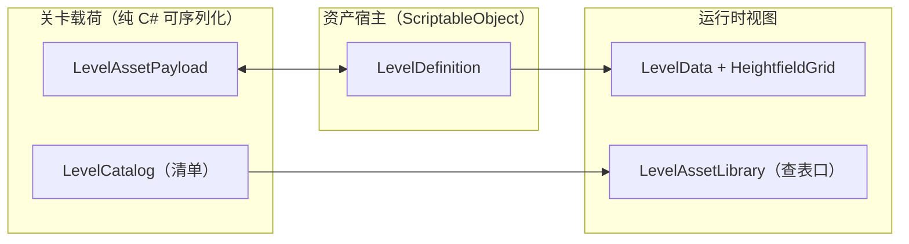

# 关卡数据资产

> **本文是什么**：关卡数据外化之后的数据模型、目录约定、改数据流程，
> 以及迁移器 / 校验器 / golden JSON 三件工具的用法与边界。
> 想了解为什么做这次外化，读 [工业级重构总纲](../../项目/工业级重构总纲.md) §3.4 与 §5；
> 想了解关卡怎么设计，读 [关卡制作管线](../../设计/关卡/00-管线与设计语言.md) 与各关设计文档。
>
> **一句话**：关卡数据是 `Assets/Data/Levels/` 下的 ScriptableObject 资产，代码里没有第二份；
> `_golden/*.json` 是同一份数据的文本渲染，逐字节对拍，既是回归锚点也是 diff 面。
>
> **关卡 = 唯一概念**（创始人 2026-10-23 裁决）：不存在「样板关 / 海图」两种关卡；
> 数据目录单一（`Assets/Data/Levels/`），旧 WorldMap 双轨管线已整链退役，
> 8 张旧图的重做口径见 [地图重做](../../项目/待办/地图重做.md)。

---

## 1. 数据模型

### 1.1 三层结构



- **载荷与宿主分家**（`Scripts/PirateCrew/Data/Levels/LevelAssetTypes.cs`）：
  字段真源放在纯 C# 载荷上，SO 只有一个 `data` 字段（`LevelDefinition.cs`）。
  理由是判据"资产内容 == golden JSON"必须在**无头环境**能算，而 SO 实例化在无头验证台走原生
  ECall 必崩（见 `external/harness/README.md`「能力边界」）。载荷可序列化 ⇒ JSON / Unity YAML /
  运行时三处渲染同一份字段，不存在"两套模型"。
- **运行时视图**：`LevelData`（`Scripts/PirateCrew/Data/LevelData.cs`，纯 C# 快照，**全米**口径）。
  载荷 → 运行时定义的转换只有 `LevelAssetPayload.ToLevelData`（`…/Levels/LevelAssetTypes.cs`）
  一处，逐字段直搬、不做"顺手修一下"。

### 1.2 `LevelAssetPayload`（关卡资产）

**坐标与数值一律用米**（Unity 世界单位）——「格」不再是对外概念，资产里一个格号都没有。

| 字段 | 语义 | 单位 / 取值 |
| --- | --- | --- |
| `levelNumber` | 关卡序号（选关 / 得分口径） | 现役 1–4（号段连续） |
| `assetName` | 资产 ASCII 名（`.asset` 文件名 / `m_Name` / JSON 文件名） | 如 `cloud_walk` |
| `displayName` | 展示名（选关页） | 中文，如「云端漫步」 |
| `sizeX` / `sizeZ` | 场地尺幅 | 米；1/2 关 40×30、化工厂 64×44 / 六件版 56×40 |
| `waterWorldY` | 水面世界 Y（低于即落水，§4.4） | 米；恒 −0.4 |
| `airdropPool` | 空投武器池 | `WeaponStack[]`，`count = 10` 表示无限 |
| `units` | 双方出战单位（顺序 = 实例化顺序） | `LevelUnit[]`：符号 / 队伍 / 世界 `x`、`z`（米，格心） / luck / 初始武器 |
| `terrain` | **岛形地形**（见 §1.3） | `TerrainShape` |
| `bakedPieces` | 烘焙陈设摆位（件 id + 世界摆位） | `ShowcasePieceId` 整数值 + instanceName |

> 一代遗留的化石字段（`originalXmlPlayers` / `sourceXmlMaxChests` / `maxChests` 等"仅存档备查"的
> 占位）不在现役载荷里；水位由 `waterWorldY` 一栏表达，取全局水面常量 −0.4。

### 1.3 岛形地形：形状即数据

`TerrainShape`（`LevelAssetTypes.cs`）= `blockWorldHeight` × `islands[]`；每座岛
`TerrainIsland` = `topY`（顶面世界高度，米）+ `outline`（俯视外轮廓多边形，米制顶点
扁平 `[x0, z0, x1, z1, ...]`）+ 可选 `holes`（内洞环列表，环岛用）。
**资产直接记录岛形**——场地设计是环形范围内的有机岛群，历史上"矩形采样数组"只是
迁移载体的遗留概念，schema 3 起根除：采样数组只存在于运行时内部。

- 运行时栅格化是**唯一**的落地处：`TerrainShapeRasterizer.ToHeights`（`Data/Levels/`，
  纯 C# 无头可测，逐采样格取格中心做 even-odd 点包含、多岛重叠取顶面最高者）→
  `LevelRasterFromAsset.Build` 折回 `HeightfieldGrid` 的**列式**分支
  （`Scripts/PirateCrew/Battle/Levels/LevelRasterFromAsset.cs`）。
- `HeightfieldGrid` 还留着平台簇模式（逐格带簇归属、水格无地面）——那是一代"悬空平台群"的形态，
  **现役内容已无生产者**；资产里不表达它（见 `Battle/Terrain/HeightfieldGrid.cs` 类头第三节的两种构造形态）。
- **采样间隔与块高**：运行时栅格化的采样间隔是 `LevelAssetSchema.RasterCellSize`
  （米/格，与 `LevelGeometry.SampleCellSize` 同值），它是**运行时地形数据的存储粒度**，
  不对玩家、不对资产暴露——资产里只有"岛是什么形状、顶面多高（米）"。
  `blockWorldHeight`（米/块）只用于把米高度折回 `HeightfieldGrid` 的整数块表示；
  存进资产是为了让资产自解释：尺度常量改了，校验器会指出哪份资产还没跟上
  （`LevelAssetRules.cs` 比对 `LevelGeometry.BlockWorldHeight`）。

---

## 2. 目录与文件约定

```
Assets/Data/Levels/
├── cloud_walk.asset ← 关卡资产（唯一真源）
├── sky_island.asset
├── chem_plant.asset / chem_plant_team.asset
├── _golden/
│ ├── cloud_walk.json ← 文本锚点（评审面 + 迁移器输入 + 对拍基准）
│ └── …
└── Resources/
    └── LevelCatalog.asset ← 唯一加载清单（Resources 路径 `LevelCatalog`）
```

> **旧海图目录已删**：`Assets/Data/WorldMaps/` 随 WorldMap 双轨退役整体移除
> （2026-10-23 裁决，见 [地图重做](../../项目/待办/地图重做.md)）。
> 重做的 8 张图按 §6 的普通关卡流程落进 `Assets/Data/Levels/`，不另设目录或清单列表。

- **资产命名 = `assetName`**：资产文件名、`m_Name`、golden JSON 文件名三者同源，
  迁移器不靠外部约定猜文件名。
- **清单必须落在 `Resources/` 下**：播放器构建里 `Assets/` 不能按路径加载（非 Resources / Addressables）。
  清单持有全部资产引用，Unity 因此把它们一并打进包；`LevelAssetLibrary` 用
  `Resources.Load("LevelCatalog")` 取它（`LevelAssetSchema.CatalogResourcePath`）。
  新增关卡漏登记 = 运行时加载不到，由内容门禁报红。
- **`.asset` 的 `m_Script` guid 由资产路径确定性派生**（`LevelAssetYaml.GuidFor`）：
  生成器 / 迁移器 / 对拍测试三处共用同一个派生式，靠"手工抄 guid"必然漂移。
  连带约束：`.cs.meta` 必须与生成时一致，**不要手改脚本文件的 guid**
  （`LevelDefinition.cs` / `LevelCatalog.cs`）。

---

## 3. golden JSON：作用与更新流程

**它是同一份数据的文本渲染，不是第二真源。** 三个用途：

1. **回归锚点**：`Assets/Tests/Battle/LevelAssetTests.cs` 断言
   `Assets_MatchGoldenJson_ByteForByte`——提交进仓库的 `.asset` 正文 == golden JSON 经
   `LevelAssetYaml` 渲染的正文（逐字节，仅行尾归一化）。即使有人手改了资产、或 Unity 版本换了序列化写法，
   这条判据都会立刻红。
2. **评审面**：资产 YAML 的高度场是 Unity 的"每行一个数"写法（300 行），人读很痛苦；
   golden JSON 把高度场写成**每行一行**（`LevelAssetJson.WriteFloatGrid`），改一处地形就是 diff 里改一行里的一个数。
3. **无头输入**：无头验证台没有 AssetDatabase，靠它读到与资产同源的关卡数据
   （`LevelAssetLibrary.LoadFromGoldenJson`；`Assets/Tests/Battle/LevelAssetTests.cs`
   的加载通道用例钉住"无头读的就是它"）。

### 改一张关卡的流程

| 步骤 | 怎么做 |
| --- | --- |
| ① 改数据 | 改 `_golden/<name>.json`（推荐，diff 可读）**或**在 Inspector 里改资产 |
| ② 落盘 | 菜单 `PirateCrew/关卡/迁移关卡资产（golden JSON → 资产）` 或 `回写 golden JSON（资产 → 文本锚点）`，跑对应方向 |
| ③ 自查 | 菜单 `PirateCrew/关卡/校验关卡资产`：连通性 / 出生点 / 高度范围 / 武器 id / 清单登记 / 文本等价 |
| ④ 门禁 | EditMode 全部用例（含 `LevelAssetGateTests`） |
| ⑤ 数值 | 若改了既有数值，`LevelAssetTests` 的**冻结期望值表**会红——那是设计定案，确认过再改表 |

> 「改动 == 改代码 + 重编译」这件事到此为止：改 JSON 或改资产都不需要碰 C#。

---

## 4. 运行时怎么读：来源解析器

关卡来源的优先级**只写在 `LevelSourceResolver` 一处**（`Scripts/PirateCrew/Battle/Levels/LevelSourceResolver.cs`）：

```
① -artReviewLevel N（N 有关卡资产） → 该关卡资产
② 有待战关卡（选关页 SetPending / -bootBattle N） → 该关卡资产
③ 否则 → 兜底关卡 1（并留下 Notice）
```

- 解析结果是 `LevelSource`：出战计划 / 逻辑高度场 / 水位 / 图幅全部已算好，
  `BattleController.BuildLevelSource` 只取数。待战槽是 `PendingLevel`（单一关卡号）。
- `Resolve(int, int)` 是**可注入的纯函数重载**：不读命令行、不读静态状态，
  故"优先级没变"是可测断言而非常识（见 `LevelAssetTests.LevelSourceResolver_*`）。
- 命令行开关：`-artReviewLevel N` / `-bootBattle N`（argv 解析在 `Core/CommandLineOptions`）。

---

## 5. 工具与判据

### 5.1 迁移器（`Assets/Editor/Levels/LevelDataMigrator.cs`）

双向，两个入口（菜单 `PirateCrew/关卡/…`，无头 `-executeMethod`）：

- `MigrateAll()`：`_golden/*.json` → `.asset` + 重写清单。写出内容只由载荷决定
  （字段顺序 / 缩进 / 数字格式全固定），**重复跑逐字节一致**；清单里的引用 guid 由路径派生。
- `WriteGoldenFromAssets()`：资产 → `_golden/*.json`（在 Inspector 里改完数据后同步文本锚点）。

**旧 C# 表怎么处置**：`ShowcaseLevels` 的两关高度场**已从源码删除**
（判据"运行时不再有硬编码关卡数据"），实现只留在 git 历史里。
一次性抽取（C# 旧表 → golden JSON）由工作台脚本 `external/levelgen/`（不入库）完成——
它是**一次性工具**，交付侧保留的是"golden JSON ⇄ 资产"这段必须能重复跑的链路。

### 5.2 校验器

判据体只有一份，两个入口共用：

| 入口 | 位置 | 覆盖 |
| --- | --- | --- |
| 规则层（纯 C#，无头可跑） | `Scripts/PirateCrew/Battle/Levels/LevelAssetRules.cs` | 出生点落位、高度范围、武器 id 在 `WeaponCatalog`、单位站位在实心地面上、编成双方非空、队伍归属与导出符号一致、栅格自洽（尺幅为采样格整数倍、与运行时采样粒度一致）、摆件 id 已登记 |
| 编辑器校验器 | `Assets/Editor/Levels/LevelAssetValidator.cs` | 规则层全部 + 文件层（golden JSON 存在 + 资产正文 == 其确定性渲染 + 清单登记/空引用/重名） |
| 内容门禁测试 | `Assets/Tests/Battle/LevelAssetTests.cs`（无头）、`LevelAssetGateTests.cs`（EditMode，`#if UNITY_EDITOR`） | 前者跑规则层 + 文本等价 + 冻结期望值；后者跑 `AssetDatabase`/`Resources` 真实加载（手写 YAML 能否被 Unity 反序列化、清单是否把现役 4 张关卡资产带进来） |

`LevelAssetGateTests` 加 `#if UNITY_EDITOR` 是必须的：无头域的 `Assets/Tests/Battle/*.cs`
不引用 UnityEditor，不加条件会把主控的 Battle 域门禁打成编译错误
（同 `Assets/Art/Tests/PixelArtTextureImportTests.cs` 的处置）。

### 5.3 语义零漂移的证据

- `LevelAssetTests.Assets_MatchGoldenJson_ByteForByte`：资产文本 == golden JSON 渲染（逐字节）。
- `LevelAssetTests.Levels_MatchFrozenLegacySignature`：**冻结期望值表**手抄自迁移前的 C# 目录表
  （`ShowcaseLevels`，git 历史），独立于资产与 golden JSON。即使有人用漂移过的数据重跑迁移器，这里也会红。
- 关卡设计契约（`Tests/SceneArt/ShowcaseLevelDesignTests`）。

---

## 6. 新增一张关卡

以新增第 5 关为例：

1. 写设计文档 `docs/设计/关卡/05-<名字>.md`（布局形制与现状口径见 `00-管线与设计语言.md`）。
2. 在 `Assets/Data/Levels/_golden/` 放 `<assetName>.json`（照抄现有 JSON 的字段顺序即可；
   `terrain.islands` 每岛写 `topY` 与 `outline` 顶点串（米）——地形是岛形轮廓，不写采样数组）。
3. 跑菜单 `PirateCrew/关卡/迁移关卡资产`：生成 `.asset` 并把它登记进 `LevelCatalog`。
4. 跑菜单 `PirateCrew/关卡/校验关卡资产` 自查；再跑 EditMode 门禁。
5. 在 `LevelAssetTests` 的 `FrozenLevelSignatures` 补一条冻结期望值，
   并确认 `ShowcaseLevels.FirstLevel/LastLevel` 与相关范围常量仍覆盖新关卡号
   （当前 `IsShowcase` 是"是否有对应资产"的查询，不再靠写死的关卡号）。

重做那 8 张旧图走同一流程（生成方法升级与 Blender 入环的口径见
[地图重做](../../项目/待办/地图重做.md)）。

---

## 7. 已知边界（登记而非顺手改）

1. 仓库 `.gitattributes` 只对 `*.meta` / `*.asset` 等钉了 `eol=lf`，**`*.json` 未钉**：
   在 `core.autocrlf=true` 的机器上重新签出时 golden JSON 会变 CRLF。
   对拍判据只比对 `.asset` 正文（已钉 LF）且 JSON 解析器容忍 CRLF，故门禁不受影响；
   但建议后续把 `*.json text eol=lf` 补进 `.gitattributes`。
2. 一代遗留的悬空注释仍在别处：如 `Scripts/PirateCrew/Ambient/AmbientRules.cs` 提到已删除的
   `Data/LevelCatalog`、`AmbientCreatureRules.cs` 提到已删除的 `Assets/Editor/SceneArtBuilder.cs`。
