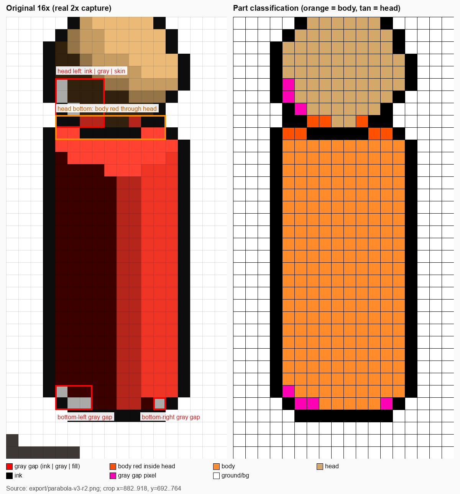

# 角色探针（绿幕观察场）

> **这份文档是什么**：`PixelartCrewProbe` 观察场的用法与读数口径。它把**同一个船员预制体**
> 单独放到绿幕前，用**实机像素管线**（`PixelartCameraRig` + Cast/Screen 渲染器 + 同一份
> shader）观察，并把像素化路径的中间缓冲原样落盘。用途是排查"填充—背景—墨线"的一像素
> 漏缝、左右镜像差、以及 2× 档块锚量化的边界行为——战斗场景里这些细节被选中件/弹道预览/
> UI 叠在一起，分不清是哪一层造成的。

## 1. 怎么打开

菜单：

- `PirateCrew/像素探针/烘焙角色绿幕观察场` —— 重新生成场景（改了装配器/材质后跑）。
- `PirateCrew/像素探针/打开角色绿幕观察场（编辑态实机管线）` —— 打开场景；
  **Game 视图不按 Play 就是实机六趟**（rig 的 `runInEditMode`）。
- `PirateCrew/像素探针/打开角色绿幕观察场（Play + 角度扫描）` —— 进 Play，F8 跑扫描。
- `PirateCrew/像素探针/抓当前帧（编辑态）` —— 对当前编辑态画面落盘。

编辑态：选中 `CrewProbeController`，在 Inspector 改 `azimuthDegrees` / `groundVariant` /
`debugView` / `visibleMeters` / `pixelScale`，`OnValidate` 即时应用。Game 视图必须可见，
分辨率用 1920×1080（= 战斗实机的 2× 档画布 960×540；换分辨率会换掉块相位的比对基准）。

Play 态：F1 面板、F7 自动对称校准、F8 角度扫描、F9 抓当前帧、F12 同 F9；右键拖拽转方位。

> **Play 路径不要在编辑态先启用 rig**：`OpenPlay/OpenPlayForSweep` 只打开场景并进 Play，
> rig 由 `CrewProbeController.Start()` 在 Play 域启用。编辑态先启用会建一套 DontSave 相机/缓冲，
> 进 Play 后可能只剩绿背景、角色不进 G-buffer。

**最终验收旋钮**（2026-10-25 收口）：`snapPhaseXArtPixels = +0.25`、`headSnapPhaseXArtPixels = +0.25`、
`snapSubjectToPixelGrid = true`、`simpleOutline = true`。相位 +0.25 是头（正球）与身（圆柱）
**各自逐行外沿同时为 0** 的唯一值；`simpleOutline` 见 §6。抓帧入口（桥）：
`PirateCrew.CrewProbe.CrewProbeController.CaptureNowInScene`。

**对称校准**：面板/Inspector 的 `screenOffsetXPixels` / `screenOffsetYPixels` 把角色沿相机
right/up 挪**整数艺术像素**（物体原点吸附保证整格）。F7 只搜 x = −2..2、y 固定 0，评分 =
`partLeaks×100 + gaps×10 + maskMismatch + inkMismatch`，挑最优相位后导全缓冲。编辑态不能
逐帧搜索，用 Inspector 手调 + 「抓当前帧」对比 `probe.txt`。**它只改相位，不改光照**：
`colorMismatch` 不会因此下降，那部分要靠角色光跟相机解决。

`headOffsetXPixels` / `headOffsetYPixels` 只挪 **HeadPivot**（不动身体），用来测“头部底缘
丢格透出身体红”这种**头/身相对相位**问题——整体平移改不了它，因为头与身体是两套原点各自
吸附。它和 `partLeaks` 配对使用：调到 `partLeaks` 最小、且头颈没有明显脱节为止。

> **不是实机管线的入口不要用**：Scene 视图走默认渲染器，六个 Feature 一个都不跑；
> `美术评审/采集评审图（当前场景 EditMode）` 是另建 review camera + ScreenCapture，
> 也不搬 rig。判像素缝只在 Game 视图或本场的落盘图上做。

## 2. 场里有什么

| 项 | 值 | 为什么 |
| --- | --- | --- |
| 角色 | 真实 `Assets/Prefabs/PirateCrew/Crew/Crew.prefab` 两件式 | 与战斗单位同一份网格 |
| 材质 | `PixelartCrewProbe_BodyRed`（#FF3A29，4 档）/ `PixelartCrewProbe_Head`（#D4A76A，4 档） | 与战斗运行期 `PixelartContentConverter` 从 CrewTeamCloth/CrewWood 派生的像素材质同口径 |
| 背景 | 相机清屏纯绿（`.linear` 预补偿） | 抠图、一眼看剪影与漏缝 |
| 地面 | 平地 / 朝相机 20° 坡 / 背相机 20° 坡 / 屋脊（两块 20×20 平面在 x=0 对折成 V） | 接触线门控依赖 depth/normal 连续性；坡/脊专测法线不连续 |
| 光照 | 运行时正午档 `#FFF4E0 / 1.55 / Euler(48,140)` + Trilight 环境 0.85，无实时影 | 与 `AmbientDirector` 每局开场应用的那一组一致 |
| 取景 | 可见 21.6 m、正交 10.8、像素档 2、俯角 30°、方位 45°、焦点抬高 `CameraFraming.LookAtHeight`、机位距离 30 m、近裁 0.1、远裁 200 | 战斗恒档（`CameraFraming`/`BattleCameraDriver` 逐参同源）；正交下距离只影响裁剪，远裁会影响归一化深度与 `closer` 门控 |
| 地面材质 | 1 档、无抖动、无内线、`_OutlinePixels=0`、`_Priority=1` | 地面不出墨、不进角色掩码；接触线仍可落地面侧 |

地面变体的用途：平地看块锚量化的固有缝；坡/屋脊看接触门控在 `closer=1 && connected=0`
时是否断线；无地面看纯剪影/镜像（此时底部没有接触墨线，不要拿它判接地缝）。

## 3. 落盘内容

产物在 `<仓库根>/export/crew-probe/<时间戳>-<capture|dump>/`：

| 文件 | 内容 |
| --- | --- |
| `result.png` | 最终艺术画布（gamma 编码，肉眼判读用） |
| `screen.png` | Play 态的 `ScreenCapture` 上屏图（2× 放大后的真实观感） |
| `char_mask.png` | 角色掩码（Patch albedo.a 且 Palette.a） |
| `ink_mask.png` | 最终墨线掩码（`OutlineClosed.r`） |
| `gap_mask.png` | 漏缝像素（白 = 命中） |
| `probe_vis.png` | **红 = 灰缝、黑 = 墨线、灰 = 角色、白 = 背景/地面**；先看这张 |
| `part_vis.png` | **橙 = 身体、茶 = 头、黑 = 墨线、青圈 = 头部圆盘、白 = 地面/背景**；看头部里有没有橙（部件漏色） |
| `body_mask.png` / `head_mask.png` | 按 albedo 色分出的身体/头部掩码（灰度） |
| `albedo_patch.png` / `albedo_patch_cover.png` | Patch 版 albedo 与覆盖 alpha |
| `palette_patch_alpha.png` | Patch 版逐物体描边开关 |
| `albedo.png` / `palette.png` / `normal0.png` / `normal1.png` / `physical.png` / `shape.png` / `rimlight_property.png` | 屏幕档 G-buffer（各 Patch 版同名 `*_patch.png`） |
| `depth_patch.png` | Patch 版 raw depth（深度附件本身不做颜色 blit） |
| `outline_pass1.png` / `outline_closed.png` | 描边第一趟 / 缝闭合第二趟（灰度） |
| `connectivity.png` / `conn_vis.png` | 连通域结论原始 RGBA / 解码可视化（R = closer 命中数，G = connected 命中数） |
| `probe.txt` | 当前角度/取景/地面/调试档 + 全部读数 + 漏缝坐标（最多 64 个） |

> ARGBHalf/RFloat 缓冲在导出时会先 blit 到 ARGB32，**负值/超 1 的值会被钳**；判读数值请回读
> 原缓冲或 compute 输出，导出的 PNG 只用于看形状。

## 4. 读数口径

`probe.txt` 的关键行：

- `gaps` / `gapRuns`：漏缝像素数与段数。漏缝 = 角色与墨线之间夹着 **1–3 个**既非角色也非
  墨线的像素（水平/垂直都查）。它会把"块被丢掉导致填充和墨线之间露出地面"与"4 邻域对角
  缺角"都算进来——这正是要找的两类形态。
- `maskMismatch`：角色掩码以画布中轴镜像后的不一致像素数（几何/覆盖的左右差）。
- `inkMismatch`：墨线掩码的镜像不一致数（描边的左右差）。
- `colorMismatch`：角色掩码内最终颜色的镜像不一致数。**它测的是光照**（世界固定主光 vs
  可转相机），不是几何；数值高是预期的，不要拿它当"左右不对称"的几何证据。
- `partLeaks`：**身体最高可见行上方**、头部圆盘内的身体红像素数（albedo 按 #FF3A29/#D4A76A
  分类，吃不到光照）。只数“身体还没开始的行”，避免把头肩同行的正常身体顶面算成漏色。
- `contourError`：**轮廓对称的唯一验收口径**——逐行取 `char ∪ ink` 的左右外沿到画布中轴的距离差之和。
- `bodyContour` / `headContour`：头/身分别的逐行左右外沿误差（块锚中心采样的部件掩码）。
  **先让头和身各自为 0，再看组合**；并集/填充 XOR/颜色差都不参与。
- `seamInk`：内部横向墨段数（长度 ≥3、上下 2 行内都有身体块）——旧接缝规则的双线诊断；
  simple 描边模式下头颈只余一条边界线（该行上方是头、不是身体，所以不计数）。
- `bodyPixels` / `headPixels` / `headDisk`：部件像素数与头部圆盘投影，用于复核 `partLeaks`
  的圆盘位置。
- `screenOffsetPixels`：当前沿相机 right/up 的艺术像素偏移（见 §2 的对称校准）。
- `bbox` / `charPixels`：角色在艺术画布上的包围盒与像素数；漏缝坐标用同一坐标系
  （y 自图像顶部，图像已做垂直翻转以匹配 PNG）。

角度扫描（Play 态 F8）按 `sweepStepDegrees` 转一圈，每个角度落 `yaw-NNN/` 的
`result.png` + 三张掩码 + `probe.txt`，并写 `sweep.csv`；结束后对 `gaps` 最多的角度再导一份
全缓冲（`worst-yaw-NNN/`）。先用 CSV 找最差角度，再打开对应的 `probe_vis.png` 看红点位置。

## 5. 已定位的形态（当前实机战斗截图 `export/parabola-v3-r2.png`）

同一帧里角色掩码/墨线镜像基本对称，但头部左缘与身体底缘出现了 `#g`/填充-灰-墨线的
一像素夹层：灰是地面（云岛阴面）透过被丢掉的 1/4 覆盖块露出来的颜色。头部底缘还有一处
**茶色头里透出身体红**（第 8 行，身体顶面 710–712 行上方）——`gaps` 抓不到（两边都是
角色色），由 `partLeaks` / `part_vis.png` 负责。逐像素证据与裁切说明见
[crew-gap/README.md](../../../images/pixelart-path/crew-gap/README.md)。它同时满足：

- 2× 档块锚落在块角，`BlockPatch` 只补"覆盖 ≥ 2/4"的块（`BlockPatch.compute`）；
- 接触线门控要求地面像素 `closer<1` 或 `connected=1 && Shape.r=1`；
- 4 邻域描边 + 第二趟只补"对向成对"的空格，不补对角空格。

本场就是用来把这三层逐层排除的：切"无地面"看纯剪影，切"屋脊"看 `conn_vis` 的
closer/connected 位，切 `debugView=Coverage/Gate` 看块级覆盖与门控，再对照
`albedo_patch_cover.png` 与 `gap_mask.png` 的同一坐标。改动任何一层后，重跑同一角度的
`probe.txt` 对比 `gaps` 即可，不靠"看起来好一点"收口。

## 6. 最终口径：+0.25 相位 + 对称覆盖膨胀描边

**相位**：头（正球）和身（圆柱）分开测，块锚中心采样的部件掩码逐行外沿——身体在
+0.10…+0.40 都是 0，头只有 +0.25 是 0，**+0.25 是两者同时为 0 的唯一相位**。−0.25 的
“并集外沿 0”是旧墨线门控把身体的不对称补偿掉的假对称，已作废。

**描边**：+0.25 时 `char` 掩码 XOR 0、理想 4 邻域膨胀 XOR 0，但旧 `connected/closer`
接缝规则让实际墨线 XOR 88、外沿差 34，并在头颈交界出两条平行墨线。现在描边支持
`_PixelartOutlineSimple`（`PixelartCameraRig.simpleOutline`，默认开）：

- 只保留“中心不描边 + 四邻域有描边物体 + 中心不比邻域更近（地面相切时保留接地线）”的膨胀；
- 跳过接缝规则②、`connected`/ground 特判与第二趟补缝；
- 头/身同属一个覆盖连通域 ⇒ 单圈 1px，接缝不会出第二条线。

**验收**（`export/crew-probe/2026-10-25-233317-409-capture/probe.txt`，开吸附、战斗同参）：
`maskMismatch=0 inkMismatch=0 contourError=0 bodyContour=0 headContour=0 seamInk=0 gaps=0 partLeaks=0`，
角色 10×32 艺术像素。证据：[probe-simple-outline.png](../../../images/pixelart-path/crew-gap/probe-simple-outline.png)、
[probe-vs-battle.png](../../../images/pixelart-path/crew-gap/probe-vs-battle.png)（左探针 / 右局内，同一
16 px/艺术像素尺度）、[battle-crew-outline.png](../../../images/pixelart-path/crew-gap/battle-crew-outline.png)。

**生产落点**：`Assets/Art/Materials/Crew/Crew*.mat` 的 `_SnapPhase=(0.25,0)`；
`PixelartObject.shader` 的 `PixelartOriginSnap` 支持 `_SnapPhase`；rig 的 `simpleOutline=true`。
`simpleOutline` 是全局描边语法开关，改动后要走查试点场/资产检视场的箱体、草地与贴地接触线。
