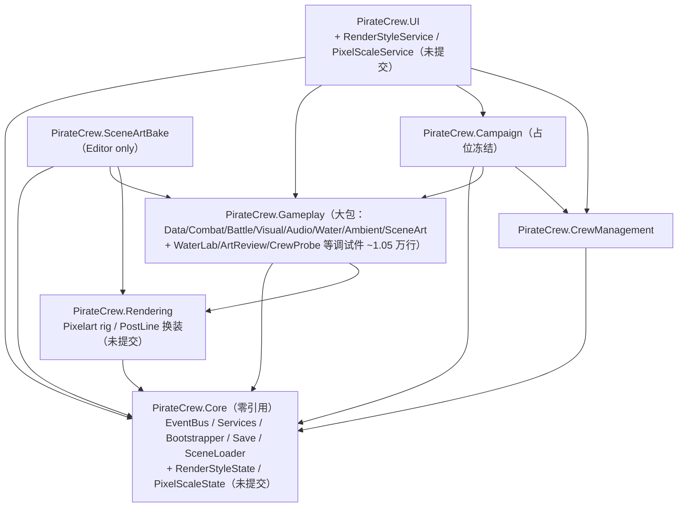

# 架构与代码质量审计

> 审计基准 commit `eb806c0c` / 2026-11-09；方法：源码与文档静态审计；未覆盖：运行时性能剖析、实机行为验证。
> **基准声明**：工作区在基准 commit 之上有 16 个已跟踪文件改动 + 18 个未跟踪 `.cs`（双渲染风格切换整套实现）。
> 本报告对**工作区现状**审计（这也是任务指定的审计对象——`RenderStyleService` / `PixelartCameraRig` /
> `PostLineMaterialSwapper` 只存在于未提交改动中）；所有引用行号均为工作区文件行号。凡只在未提交改动中成立
> 的发现均已标注。

## 结论摘要

整体健康度**高**：分层纪律被 asmdef 钉在编译期且实际零违规；「纯 C# 规则层 / MonoBehaviour 胶水层」的分界
严格执行；全仓 `Update`/`LateUpdate` 扫描仅 3 处分配嫌疑（均为调试或缓存形态）；错误处理口径统一
（分级 Log + 幂等 + 失败可见不静默）；测试 109 文件 2.2 万行且与无头验证台配套。这不是一个需要"救火"的
代码库。

最痛的三件事：**① 未提交工作规模失控**——双渲染风格切换整套（18 个未跟踪 `.cs` + 16 个修改文件 + 4 个
新 shader + URP 资产）全部悬在工作区，基准 commit 不含它，契约测试 / 查找闸门 / 文档口径对这套代码全部
失明，任何并行动都可能撞车或丢失；**② 运行期查找闸门有真实逃逸口**——`SceneLookupAudit` 的扫描正则漏了
`FindFirstObjectByType`（Unity 2022 推荐的单对象查找 API），已有多处运行时调用从闸门下穿过；**③ 文档-代码
漂移集中爆发**——架构总览三处关键契约（入口唯一性 / 八步装配链 / 白名单 7 处）与代码不符，而它们恰是
AGENTS.md 导航表里"改前必读"的口径文档。

## 分层与依赖

程序集依赖图（实测自各 `.asmdef`，箭头 = "引用"）：

**违规点：程序集引用层面零违规**。10 个 asmdef 的引用方向与架构总览 §1 表格逐条核对一致；`Core` 不引用
任何游戏程序集；无环；SceneArtBake 正确 `includePlatforms: Editor`。分层纪律是真实成立的。

依赖层的**结构性**问题（非违规，是布局权衡）见问题清单 P2-2 / P2-3 / P2-6。

## 主要问题清单

### P0-1 双渲染风格切换整套代码未入库，审计基准与代码真源分叉

- **位置**：未跟踪 `Assets/Scripts/Core/RenderStyleState.cs`、`Assets/Scripts/UI/RenderStyleService.cs`、
  `Assets/Scripts/UI/PixelScaleService.cs`、`Assets/Scripts/PirateCrew/Rendering/PostLine/`（整目录）、
  `Assets/Scripts/PirateCrew/Settings/RenderStyleStore.cs` 等 18 个 `.cs`；修改 `PixelartCameraRig.cs`、
  `MainMenuController.cs`、`UiScreenBuilder.cs`、4 个 shader、2 个 URP 资产等 16 个文件；未跟踪文档
  `docs/技术/渲染/管线/双风格切换.md` 等三份。
- **现象**：`git show eb806c0c:pirate-crew/Assets/Scripts/Core/RenderStyleState.cs` → "exists on disk,
  but not in 'eb806c0c'"。整套功能（含它在 `PixelartCameraRig` 里的接入分支、设置页 UI、存档槽读写、
  新增测试 `RenderStyleStoreTests`）只存在于工作区。
- **为什么是问题**：本仓一切质量机制都以"已提交的 HEAD"为对账基准——契约测试冻结的是 `Steps` 表，
  查找闸门白名单登记的是已提交路径，文档口径跟着 commit 走。一套跨 Core/Rendering/UI/Settings/资产
  五个域的功能悬在工作区，意味着：换机器/误操作即丢整套实现；并行的其他 worktree 看不到它；它的
  行为没有任何"基准"可对账。
- **建议**：按模块拆成几个提交尽快收口（Core 状态类 → Rendering 双链 → UI 服务与设置页 → 资产与文档），
  提交前补 P1-4 的白名单登记。在这之前，任何"以 eb806c0c 为基准"的整改都不应动手。

### P1-1 查找闸门正则漏 `FindFirstObjectByType`，清退存在真实逃逸口

- **位置**：`Assets/Editor/SceneLookupAudit.cs:57-61`（`LookupPattern`）。
- **现象**：正则覆盖 `GameObject.Find / FindObjectOfType / FindObjectsOfType / FindAnyObjectByType /
  FindObjectsByType / FindWithTag / Camera.main / transform.Find`，**唯独没有 `FindFirstObjectByType`**。
  注意 `FindObjectsByType` 模式匹配不到 `FindFirstObjectByType`（串里是 "FirstObject" 不是 "Objects"）。
- **已发生的逃逸**（运行时代码、非白名单、闸门扫不到）：
  - `Assets/Scripts/PirateCrew/Battle/BattleController.cs:386` — `FindFirstObjectByType<AmbientDirector>()`
    （SpawnTeams 里一次性）；
  - `Assets/Scripts/PirateCrew/CrewProbe/CrewProbeController.cs:677,689,714,738`；
  - `Assets/Scripts/PirateCrew/GeoProbe/GeometryProbeController.cs:49`。
- **为什么是问题**：架构总览 §7.3 把 SceneLookupAudit 定为"白名单外的命中 → 退出码 1"的硬闸门；闸门
  漏掉 Unity 官方推荐的单对象查找 API，等于给"运行期查找清退"这条纪律留了一扇不记账的门——新代码
  用 `FindFirstObjectByType` 写依赖查找不会被拦，白名单的"唯一真源"地位失效。
- **建议**：正则加 `FindFirstObjectByType` 分支；随后实跑一次闸门，把上述 6 处命中逐条分类（登记或清退）。
  一行正则 + 一次盘点，收益/成本比全场最高。

### P1-2 「全仓唯一 RuntimeInitializeOnLoadMethod」契约已破，实际 6 处

- **位置**：对照 `docs/技术/架构/架构总览.md` §4.2 规则 2（"禁止自挂
  `[RuntimeInitializeOnLoadMethod]`"，并声称 grep 只应命中 `GameEntryPoint.cs`）。
- **实际命中 6 处**：
  | 位置 | 时机 | 性质 |
  | --- | --- | --- |
  | `Scripts/Core/GameEntryPoint.cs:42` | BeforeSceneLoad | 文档认可的唯一入口 |
  | `Scripts/UI/RenderStyleService.cs:26` | AfterSceneLoad | 未提交；安装 + 读档 |
  | `Scripts/UI/PixelScaleService.cs:34` | AfterSceneLoad | 安装 + 读档 + 应用画布 |
  | `Scripts/PirateCrew/WaterLab/WaterLabReplicaGlobals.cs:69` | AfterSceneLoad | 实验水体全局量发布 |
  | `Scripts/PirateCrew/Battle/SelectionCube.cs:71` | SubsystemRegistration | 静态残留重置 |
  | `Scripts/UI/Skin/UiGlyphs.cs:53` | SubsystemRegistration | 静态残留重置 |
- **为什么是问题**：这条规则是重构收口的核心战果（"重构前 14 处分散在 5 个程序集"），现在又回到了
  5 处自挂。各处注释都写了自认的理由（"编辑器域不触发安装""SubsystemRegistration 早于程序集加载"），
  但它们绕过了 `GameBootstrap` 的两阶段声明机制——接线顺序重新变成"执行时机"而不是"代码声明"：
  两个 AfterSceneLoad 之间无顺序保证，`RenderStyleService.Install` / `PixelScaleService.Install` 依赖
  "SaveManager 已由 BeforeSceneLoad 的 Bootstrapper 建好"这一隐式时序，一旦有人把 Bootstrapper 服务
  创建挪后就会静默读不到档。
- **建议**：二选一并写进架构总览：要么把这些安装口收编为 `[GameBootstrap(Initialize)]` 声明
  （`GameBootstrap.RunPhase` 走反射，能发现它们）；要么修订 §4.2 为"BeforeSceneLoad 唯一 +
  AfterSceneLoad/SubsystemRegistration 白名单清单（每处带理由）"，与查找闸门的白名单纪律同构。
  当前状态是"规则还在文档里，代码已经不认"。

### P1-3 装配链文档写八步、代码与契约测试都是七步

- **位置**：`Assets/Editor/BattleScenePipeline.cs:49-83`（`Steps` 表，7 步）；
  `Assets/Tests/Battle/SceneAssemblyContractTests.cs:233`（`FrozenBattlePipelineSteps`，7 项，与代码一致）；
  对照 `docs/技术/架构/架构总览.md` §7.1（"重建骨架 → … → WorldKit 资产表 → 折叠为 Prefab 实例"，8 项）
  与 `pirate-crew/Assets/Scenes/README.md` §二表格（①-⑧，其中 ⑦=WorldMapAssetSetBuilder、⑧=Collapse）。
- **现象**：代码里已无 `WorldMapAssetSetBuilder` 装配步骤（WorldMap 双轨退役，见 `CampaignApi.cs:16-18`
  注释），两份导航级文档仍写八步并把它列为第 ⑦ 步。
- **为什么是问题**：这两份文档都在 AGENTS.md 导航表"改 Battle 场景前必读"的位置；按文档数步骤、按文档
  找第 ⑦ 步的执行入口，会直接找不到。契约测试冻结的是 7 步——文档与测试口径相反，测试红不了文档。
- **建议**：改两份文档的步骤表为七步实况；若 WorldMap 结算链将来解冻，同步恢复。

### P1-4 未提交的 `PostLineMaterialSwapper` 未登记查找白名单（新增违规即成事实）

- **位置**：`Assets/Scripts/PirateCrew/Rendering/PostLine/PostLineMaterialSwapper.cs:50` —
  `Object.FindObjectsByType<Renderer>(FindObjectsSortMode.None)`（PostLine 模式下每 30 帧一次，
  见 `PixelartCameraRig.cs:676-680`）。
- **现象**：`SceneLookupAudit.cs` 的白名单（31 条）中 `PostLine` 命中数为 0。
- **为什么是问题**：这是已提交闸门口径下**必然违规**的运行期全场扫描——如果闸门在当前工作区跑，
  退出码 1。它说明"新功能开发→闸门收口"这条流程在未提交批次里断了；同批的
  `PixelartCameraRig.cs:1010`（`FindObjectsByType<MeshRenderer>`）同样需要核对登记。
- **建议**：与 P0-1 的提交一起，给两处补白名单登记（理由：切换瞬间的场景级遍历 / 低频增量补换装），
  并顺带评估 P2-1 的有界化。

### P2-1 PostLineMaterialSwapper 的静态集合无界增长 + 周期性全场扫描

- **位置**：`PostLineMaterialSwapper.cs:21-28`（`s_Converted` / `s_Applied` / `s_HandledIds` 三个 static
  集合）、`:50`（每次 `Refresh` 全场 `FindObjectsByType<Renderer>`）、`PixelartCameraRig.cs:676-680`
  （每 30 帧调用）。
- **现象**：`s_HandledIds` 只增不清（渲染器销毁后 InstanceID 残留，长会话慢膨胀）；`s_Converted` 按
  源材质缓存派生材质，跨切换复用是设计意图，但源材质是运行时生成（弹体兜底材质每弹一份）时缓存
  只在域重载时释放；PostLine 模式驻留期间每 30 帧做一次全场 Renderer 扫描 + sharedMaterials 数组分配。
- **为什么是问题**：切换是低频操作，但"驻留在 PostLine 模式打完整局"是常态路径——每 30 帧一次全场
  扫描在单位/地形数量大的关卡有可测成本；静态集合跨局存活（域重载关闭时不清理），是除
  `RenderStyleState`/`PixelScaleState` 之外又一组未登记进 ResetStatics 纪律的静态可变状态。
- **建议**：`Refresh` 改为对"运行时生成物的注册回调"（弹体/地形生成处已在 `BattleController` 单点，
  生成后调用一次 `Swapper.Adopt(go)` 即可消除周期扫描）；`Exit()` 时清 `s_HandledIds`；`GameBootstrap
  ResetStatics` 收编或注明豁免理由。

### P2-2 运行时 Gameplay 程序集驻留约 1.05 万行调试/实验代码

- **位置**：`Scripts/PirateCrew/` 下的 WaterLab(5049 行) / CrewProbe(1888) / ArtReview(1568) /
  AssetInspect(869) / CharCamDebug(672) / GeoProbe(167) / SceneKitPilot(141)。
- **现象**：发行场景与 Prefabs 零引用（grep 证实）；`AssetInspectController` 与 `UiKit` 的 UnityEditor
  调用有正确的 `#if UNITY_EDITOR` 守卫，但类型本身全部编译进播放器构建（MonoBehaviour 不被引用不等于
  不进包，托管裁剪等级不够时全保留）。
- **为什么是问题**：架构总览 §11.1 已登记"Gameplay 是大包"的拆分提案——这 1.05 万行是拆分收益的
  主要构成。它们与玩法核心同程序集，意味着 WaterLab 实验期任何编译错误都会挡住玩法迭代，且
  "出图工具能不能引用游戏内部类型"的边界靠目录约定而不是程序集边界。
- **建议**：优先级高于 §11.1 现有表述——至少把 WaterLab（实验水体）拆成独立 asmdef 或 `Editor`
  平台收窄；探针类（CrewProbe/GeoProbe/AssetInspect）可合并为一个 `PirateCrew.DevProbes`
  （Editor-only 或 development-build 条件）。

### P2-3 渲染档位/风格的运行时服务住在 UI 程序集（最上层）

- **位置**：`Scripts/UI/RenderStyleService.cs`、`Scripts/UI/PixelScaleService.cs`（PirateCrew.UI 程序集）；
  读取方 `PixelartCameraRig`（Rendering 程序集）；真值 `RenderStyleState` / `PixelScaleState`（Core）。
- **现象**：像素比例与渲染风格是**渲染 + 设置**的关注点，其服务（读档/写档/应用）却放在依赖链最顶端的
  UI 程序集（因为要摸 `CanvasScaler`）。链路变成：UI 写 Core 真值 → Rendering 每帧轮询 Core 真值。
- **为什么是问题**：功能上自洽（注释把"为什么放 Core/为什么轮询"都论证过了），但结构上"改渲染风格的
  入口"对非 UI 消费者不可达——如果将来战斗内 HUD 或调试面板要切风格，就得反向引用 UI 程序集或再开
  一个静态类。轮询而非事件是 Rendering 不能引用 UI 所致，属于分层倒逼的妥协。
- **建议**：中期把两个 Service 的"非画布"部分（Store 读写 + 真值写入）下沉到 Settings 所在的
  Gameplay 程序集或独立 `PirateCrew.Settings` 程序集；`CanvasScaler` 遍历留 UI。顺带删除
  `RenderStyleService.OnSceneLoaded`（`RenderStyleService.cs:76-79`）这个空订阅钩子。

### P2-4 `BattleController.ApplyPhysicsConvention` 全局改物理参数且不还原

- **位置**：`Assets/Scripts/PirateCrew/Battle/BattleController.cs:341-345`。
- **现象**：Awake 里写 `Physics.gravity` 与 `Time.fixedDeltaTime`（战斗口径：-30 m/s²、25 Hz）。BattleController
  随场景销毁，但这两项是引擎全局态——离开战斗场景回主菜单后重力仍是 -30。
- **为什么是问题**：菜单/管理界面当前没有刚体，症状不可见；但任何后来者往菜单加一个带物理的物件
  （掉落奖励、过场动画）就会吃到战斗重力，且查因方向会被带偏（"谁改了重力"没有留痕）。这是文档
  §7.3"显式接线"纪律没有覆盖到的相邻盲区：场景对象改引擎全局态。
- **建议**：`OnDestroy` 恢复入场前快照（Awake 时先记旧值）；或在类头注释登记"本值是进程级口径、
  刻意不还原"的显式豁免——两者都行，不能都不做。

### P2-5 四个设置 Store 各写一遍"槽 9 读改写 + Save"，模板重复

- **位置**：`AudioSettingsStore` / `PixelScaleStore` / `RenderStyleStore` / `VideoSettingsStore`
  （`Scripts/PirateCrew/Settings/` 与 `Scripts/PirateCrew/Audio/`），配合
  `PixelScaleService.Save()`（`PixelScaleService.cs:77-91`）与 `RenderStyleService.Save()`
  （`RenderStyleService.cs:60-74`）两段近乎逐行相同的实现。
- **为什么是问题**：槽位语义（槽 9、读改写保留同槽其它键、`SettingsDisplayName`）分散在四处，
  新增第五个设置项时最容易抄错的是"读旧档合并"这段。当前四处都对，属于"还没坏但会坏"的重复。
- **建议**：低优先级。抽一个 `SettingsSlotCodec`（读改写 + 写回两行 API）或在第五个设置项出现时再抽。

### P2-6 架构总览 §1 mermaid 图例与箭头方向语义相反

- **位置**：`docs/技术/架构/架构总览.md` §1（"绘制成图（箭头 = "可引用"）"+ 图中 `Core --> Crew` 等）。
- **现象**：asmdef 事实是 CrewManagement 引用 Core；图与图例合读变成"Core 可引用 Crew"。只有按
  "箭头 = 被引用"读图才与事实相符。
- **为什么是问题**：这是全仓分层口径的定图；新会话按图例理解会得出相反的依赖方向。
- **建议**：改图例为"箭头 = 被引用（源是被依赖方）"，或翻转箭头。一处文案改动。

### P2-7 架构总览 §11.2「仍有 7 处在白名单里」严重过时

- **位置**：`docs/技术/架构/架构总览.md` §11.2；事实真源
  `docs/项目/审计/运行期查找清退报告.md`（2026-10-23 口径：当前调用点 41、白名单 31 条、僵尸 0）与
  `Assets/Editor/SceneLookupAudit.cs`（31 个 `new WhitelistEntry`）。
- **为什么是问题**：AGENTS.md 的文档纪律是"机器事实不进散文、以真源为准"——这行恰是违反自身纪律
  的具体数值，且已漂移 4 倍。
- **建议**：改为"当前调用点与白名单以 `运行期查找清退报告.md`（脚本扫描产物）为准"。

### P2-8 `RenderStyleState` 注释引用的规格文档未入库

- **位置**：`Assets/Scripts/Core/RenderStyleState.cs:4`、`PixelartCameraRig.cs:452` 引用
  `docs/技术/渲染/管线/双风格切换.md`——该文件工作区 untracked，基准 commit 不存在。
- **为什么是问题**：代码指向的"口径文档"在没有该工作区的检出里是死链；本仓注释引用文档是普遍实践，
  死链破坏这条惯例的可靠性。
- **建议**：随 P0-1 一并提交。

### P2-9 「Pixelart」一词四义、「WaterLab」代码横跨四处

- **位置**：`Assets/Pixelart/`（shader/compute 资产 + 编辑器安装器）、
  `Assets/Scripts/PirateCrew/Rendering/Pixelart/`（运行时 rig，程序集 PirateCrew.Rendering）、
  `Assets/Scenes/Pixelart/`（开发场景集）、`PixelSkin`（UI 皮肤）；
  WaterLab 分别在 `Scripts/PirateCrew/WaterLab/`（运行时）、`Scripts/PirateCrew/Rendering/WaterLabColorDump.cs`
  与 `WaterLabDofAutofocus.cs`、`Assets/Pixelart/`、`Assets/Scenes/Lab/WaterLab.unity`。
- **为什么是问题**：名字不区分"管线资产 / 运行时渲染 / 开发场景"三个概念，跨域检索与新人定位成本高；
  WaterLab 尤其散——实验代码的边界在目录上看不出来。
- **建议**：随 P2-2 的程序集拆分一起重划目录；命名区分 `Pixelart/`（管线）与 `Rendering/Pixelart/`
  （运行时）至少在 README 层说清。

### P2-10 `WaterSimulationDriver.Update` 禁用态仍逐帧写 shader 全局

- **位置**：`Assets/Scripts/PirateCrew/Water/WaterSimulationDriver.cs`（Update 开头
  `Shader.SetGlobalFloat(GlobalEnabled, ...)` 两分支都逐帧执行）。
- **为什么是问题**：极低成本但违背"禁用即零开销"直觉；同类 `Shader.SetGlobalFloat` 全局量在
  `PixelartCameraRig.PushLightGlobals`（每帧 12+ 项）同样逐帧推送——这些全局量构成一组隐式契约，
  写入方与读取方（shader）之间没有编译期或测试约束，shader 改名/删字段只能实机炸。
- **建议**：登记为已知取舍即可；若做，禁用分支只在值变化时写一次。

## 设计亮点

1. **分层是编译事实不是口头约定**：10 个 asmdef 引用方向与文档表格完全一致（逐条核对过），"架构总览
   §1 的三条依赖规则"在代码里零违规；SceneArtBake 正确收窄到 Editor 平台。
2. **规则层/胶水层分界真实执行**：`ExplosionResolver` / `TurnRules` / `StarRules` / `SpawnGroundRules` /
   `CameraFeelRules` 等纯 C# 规则类可无头测试，`BattleController` 只做"取引用 → 换标 → 调纯函数"，
   爆炸结算的 Flash 像素口径换算集中在 `LevelGeometry` 一处。
3. **EventBus 的类型化频道**：键与载荷编译期锁定、快照缓存热路径零分配（`EventBus.cs:328-386`）、
   误用守卫带 64 条上限的诊断记录、逃生口 `SubscribeDynamic` 全仓唯一使用处（`AudioService.cs:298`）
   与契约文档完全吻合——抽样核对的契约里这是执行得最严的一条。
4. **装配链是代码**：`BattleScenePipeline.Steps` 一条语句链 + `SceneAssemblyContractTests` 反射冻结顺序 +
   折叠态不变量（0 裸对象 / 1 纯实例 / 无覆盖）双通道可检；`Battle.unity` 实测 186 行。
5. **数据三层与双通道对拍**：`LevelAssetPayload`（纯 C# 真源）+ SO 宿主 + golden JSON；schema 版本 4
   带迁移语义；存档版本比较"解析不动宁可拒绝"（`SaveManager.CompareVersions`）与"静默读档不广播"
   （`TryLoadSlotQuiet`）这类边界语义都有明确裁决和注释。
6. **热路径纪律**：全仓 Update/LateUpdate/FixedUpdate 扫描仅 3 处分配嫌疑（SelectionCube 的 GetComponent、
   两个调试组件）；`OverlapSphereScratch` grow-only + 装满上限吵闹一次；爆炸诊断日志用
   `[Conditional]` 让字符串构造整体剪除。
7. **失败可见不静默**：`Bootstrapper.EnsureInstalled` 幂等 + 重复宿主告警；`PixelartCameraRig` 设备不支持时
   整趟 inert + LogWarning 一次（明确区分环境事实与缺陷）；PostLine 渲染器未装配时回退并告警
   （`PixelartCameraRig.cs:467-472`）；`BattleMinimap` 建图失败限频重试 + 放弃后不再每帧扫描。
8. **注释即档案**：几乎每个非常规决策都带裁决日期、实测症状、契约文档指针（如 `PixelartCameraRig`
   里"掩码不能清成 0"的 Cinemachine 教训、`EnsureOverlayCamera` 的"独立 Base 会整屏盖掉"实测），
   本次审计大量结论可直接从代码注释溯源。

## 测试与验证策略评估

**结构**：EditMode 109 文件约 2.25 万行，按域分布 Battle 28 / Combat 8 / Water 8 / SceneArt 8 / UI 9 /
Audio 7 / Ambient 5 / Data 5 / WaterLab 5 / Rendering 3 / Core 3 / Campaign 3 / CrewManagement 2 / Settings 3 /
Audit 1 / Visual 3；PlayMode 4 文件（接线 / 冒烟 / 主链 E2E / 场景流转）。与"无头验证台秒级档 +
单飞锁 + 结果缓存"的验证基建配套，策略本身是全场最强项。

**结构性缺口**（按目录与代码判断，未实跑）：

- **Rendering 程序集覆盖最薄**：24 文件 5794 行对 3 个测试文件（`PixelartPureFunctionsTests` 覆盖 rig 纯函数、
  `PixelartLevelSceneTests`、新增 `PaletteLutLayoutTests`）。像素化 rig 的缓冲生命周期、连通域 feature、
  叠加相机栈这些"错了就花屏"的路径只有纯函数被钉住，其余依赖实机。
- **PostLine 链零测试**（未提交代码）：`PostLineMaterialSwapper` 的换装/还原对称性、同源材质缓存复用、
  切回还原次序，都是纯 C# 可测逻辑（Map<Material,Material> + 列表还原），没有测试。
- **双风格切换的服务层无测试**：`RenderStyleStoreTests` / `PixelScaleStoreTests` 钉了 Store 读写，但
  `SetStyle` → rig 轮询 → `ApplyRenderStyle` 的切换矩阵（未装配回退 / Cast 相机启停 / 材质还原）没有
  任何测试覆盖——且按 `DeviceSupportsPath` 的注释自认，无头环境 rig 整趟 inert，PlayMode 也测不到热切。
  这条链的验收目前完全依赖实机目检，与"验收标准：契约测试 + 量化指标优先"的仓规有落差。
- **UI 程序集**：63 文件 18992 行对 9 个测试文件；控件/皮肤序列化有棘轮测试，`AseDialogLoader`
  （XML 解析 + 盒模型语义子集）这类纯解析器适合无头测试但未见对应测试文件。
- **编辑器工具**：80 文件 27084 行，仅 `SceneAssemblyContractTests` 反射收口装配链；查找闸门本身
  （正则、白名单分类）无自测——P1-1 的正则盲区恰说明它需要一条"模式串覆盖清单"的元测试。

## 建议的整改顺序（按投入产出）

1. **收口双风格切换工作区**（P0-1 / P1-4 / P2-8 一批）：提交前补 2 条白名单登记。不做这步，
   后续所有整改都没有稳定基准。
2. **`SceneLookupAudit` 正则补 `FindFirstObjectByType` + 一次盘点**（P1-1）：一行正则 + 6 处分类，
   关闭当前唯一真实的纪律逃逸口。
3. **文档三处漂移修正**（P1-3 / P2-6 / P2-7，加 P1-2 的口径二选一）：纯文档改动，半小时级，
   换回"改前必读文档可信"。
4. **`RuntimeInitializeOnLoadMethod` 收编或豁免登记**（P1-2）：若选收编进 `GameBootstrap`，
   注意 `PixelScaleService.Install` 依赖 `SaveManager` 在位的时序要在声明顺序里显式化。
5. **`PostLineMaterialSwapper` 有界化**（P2-1）：生成回调替代 30 帧全场扫描；`Exit` 清 `s_HandledIds`。
6. **物理口径还原或显式豁免**（P2-4）：`OnDestroy` 快照恢复，三行代码。
7. **Gameplay 拆包提级**（P2-2 / P2-9 / P2-3）：架构总览 §11.1 已有提案，本审计建议把 WaterLab 与
   探针类列为首批拆出对象，双风格服务下沉其次。
8. **Settings Store 模板抽象**（P2-5）：第五个设置项出现时再做。

## 未覆盖区与审计局限

- **运行时性能剖析**：每帧成本、RT 带宽、PostLine 每 30 帧全场扫描的实际毫秒数、`PushLightGlobals`
  每帧 12+ 全局量的开销——只有静态判断，无实测数据。
- **实机行为验证**：双风格热切、设备不支持路径、关闭 Domain Reload 的静态残留、场景栈重载——全部
  未实跑（任务约束：不启动 Unity、不跑 batchmode、不跑测试）。
- **shader / compute 资产内容**：只审计了 C# 侧的引用纪律（`PixelartShaders` 单一取用口、compute 必须
  资产引用的注释口径），未审 shader 本体与工作区未提交的 4 个 PostLine shader。
- **`Assets/Pixelart/Editor/`**（`PaletteLutBuilder` / `PostLineInstaller` 等 untracked 编辑器工具）只粗扫，
  未逐行；`Assets/Pixelart/` 与 `Assets/Editor/` 两个编辑器工具聚集地的职责分界未深查。
- **测试实跑结果**：测试数量、通过率以 Test Runner 实跑为准（本仓文档纪律：机器事实不进散文）。
- **`external/`**：gitignored 工作台（harness / 参照库 / 逆向材料），不在审计范围。
- **数据资产内容**：golden JSON 与 `.asset` 的对等性由 `LevelAssetTests` 门禁保证，本审计未复算内容。
